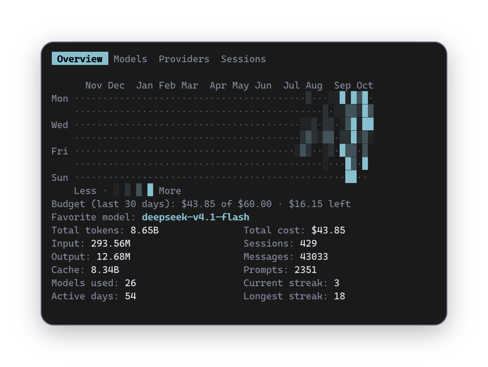
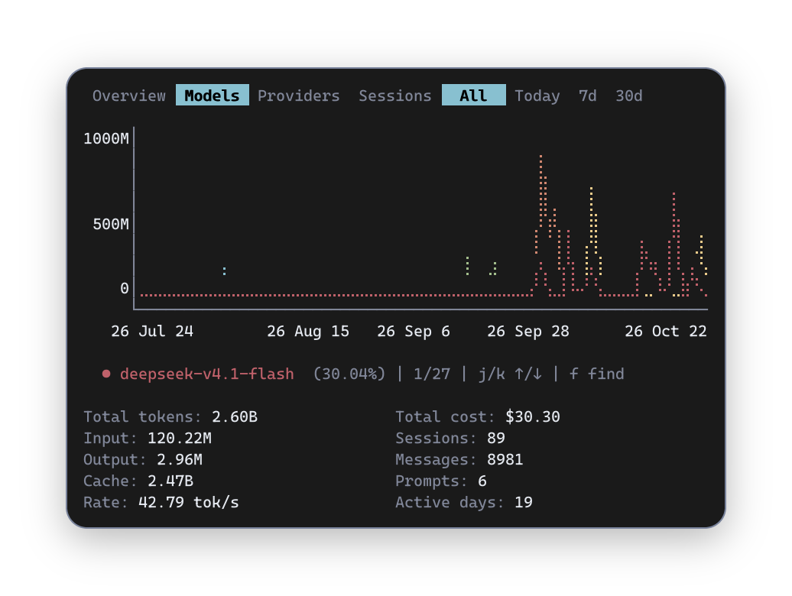
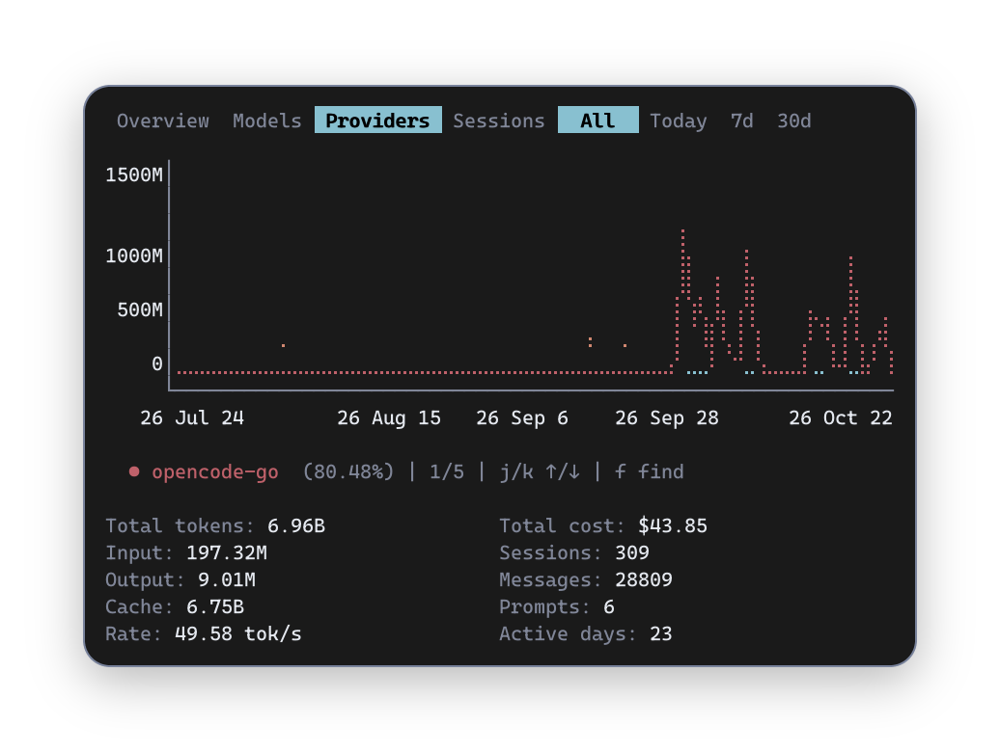
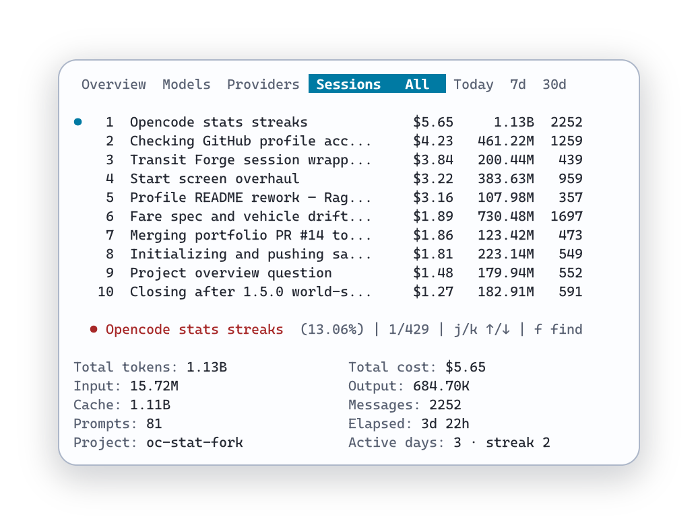

<h1 align="center">OpenCode Stats</h1>

<p align="center">
  <b>A personal fork of <a href="https://github.com/Cateds/opencode-stats">Cateds/opencode-stats</a></b>
</p>

<p align="center">
  <a href="https://ratatui.rs/"></a>
  <a href="https://github.com/Cateds/opencode-stats"></a>
</p>

A terminal dashboard for OpenCode usage statistics.



`oc-stats` reads your local OpenCode SQLite database and displays token usage, cost estimates, model and provider distributions, and a 365-day activity heatmap directly in your terminal. Inspired by Claude Code's `/stats` command, this is an independent implementation focused on local execution, export, and shareability.

> If you're already using OpenCode and want a quick view of your usage, costs, and activity trends, this tool is ready to go.
>
> This is an unofficial community project and is not affiliated with, endorsed by, or maintained by the OpenCode team.

## This fork

This repository is **my personal fork** of [Cateds/opencode-stats](https://github.com/Cateds/opencode-stats). The tool itself, its design and everything it got right are the work of [@Cateds](https://github.com/Cateds) — if you want the upstream project, that is where it lives. Everything below describes the fork you are reading, which I run daily and keep my own changes on top of.

### What I changed

**Numbers you can trust**

- Reads OpenCode's current `session_v2` and `session_message` tables, de-duplicates rows that also exist in the legacy `message` table, and counts `compaction` calls as billed usage. Upstream read the legacy tables alone, which on a migrated database hid most sessions and most of the cost.
- Cost comes from what OpenCode stored for each row, so totals reconcile exactly against the database.
- Free models are included, never filtered out: a model that cost nothing is still a row, and its tokens count towards every total.

**A heatmap that reads**

- Five-level colour ramp derived from the active theme, with a legend to match.
- Buckets by activity percentiles instead of fractions of the busiest day, so one heavy day cannot flatten a year of usage into the lowest shade.

**Scriptable output**

- `oc-stats stats` prints one machine-readable line, JSON or CSV; `--out PATH` writes it to a file; `--range all|today|7d|30d` selects the window. A missing or unusable database exits non-zero with a single line rather than printing zeros.

**The dashboard**

- A `Sessions` page ranked by cost, beside `Models` and `Providers`.
- Live reload of the database without restarting.
- `Overview` is the whole picture: always all time and without a range selector. The range applies to `Models`, `Providers` and `Sessions`, and is remembered while you move between pages.
- A spending cap on the `Overview`: what the last 30 days cost, the cap, and what is left.
- Activity streaks: the current run of days and the longest one, on the `Overview` and on every session.
- The sessions list scrolls with the focus and stays inside its own area.
- Copy the current view as a share card with `Ctrl+S` or `s`: the image goes to the clipboard, the card is also written as a PNG beside your exports, transient clipboard failures are retried, and the footer names exactly what landed.

**Configuration**

- A `config.toml` with optional sections: `[app]` (`page`, `range`, `db`, `reload_every`), `[view]` (`project`, `pinned_models`, `pinned_providers`), `[budget]` (a spending cap), `[brand]` (your own strings) and `[theme]`. Every key is optional, and an invalid value fails at startup naming the key and the accepted values.
- Database precedence is `--db`, then `[app] db`, then `OC_STATS_DB_PATH`, then discovery.
- The full reference — every section, its values and defaults — is in [`docs/config.md`](docs/config.md).

**Fixes**

- A database that has only the modern tables (a fresh OpenCode install) no longer fails to load.
- OpenCode's configuration is read from where it actually lives on Windows (`~/.config/opencode`), not `%APPDATA%`.
- The range strip never clips its last label, at any terminal width.

**Housekeeping**

- Dead code deleted, the `colored` and `itertools` dependencies dropped, and one usage-row type in place of several.

Every change has tests, and the reported figures are cross-checked against independent SQL over the same database.

## Features

- Terminal dashboard UI built on `ratatui`
- Automatically reads the OpenCode local database
- Displays total tokens, costs, session count, message count, prompt count, and other overview metrics
- View usage breakdown by model and provider
- Supports four time ranges (all time, today, last 7 days, last 30 days) on the `Models`, `Providers` and `Sessions` pages; `Overview` always shows all time
- Built-in 365-day activity heatmap for observing long-term usage trends
- Supports dark / light theme via command-line argument
- Copy the current view to the clipboard as a share card, with the card also written as a PNG beside your exports and an automatic fallback to a text summary (`Ctrl+S` or `s`)
- Local model pricing cache with update / clean commands
- Output data calculation aligns with `opencode stats` and `opencode stats --models` for consistency

## Preview

OpenCode Stats provides three data perspectives:

| Year view                                                     | Model usage                                                 | Provider usage                                                    |
| ------------------------------------------------------------- | ----------------------------------------------------------- | ----------------------------------------------------------------- |
|  |  |  |

There is a fourth page, `Sessions`, which ranks your sessions by cost, tokens and messages.

Each page also supports exporting a transparent-background share card directly to clipboard:



## Installation

> The crates.io package and the pre-built release archives track **upstream**. To run the changes in this fork, install from this repository.

### Install from this repository

```bash
cargo install --git https://github.com/Raghav2012Code/opencode-stats
```

After installation, run:

```bash
oc-stats
```

### Install upstream from crates.io

```bash
cargo install opencode-stats
```

### Download pre-built binaries from GitHub Releases

Pre-built Windows binaries are published with each release on this repository's
[releases page](https://github.com/Raghav2012Code/opencode-stats/releases).
Download the archive, extract it, and run `oc-stats` directly.

Upstream publishes its own archives on the [Cateds/opencode-stats releases
page](https://github.com/Cateds/opencode-stats/releases); those contain
upstream's build, not this fork's. Upstream's archives cover:

- Windows `x86_64-pc-windows-msvc`
- macOS `x86_64-apple-darwin`
- macOS `aarch64-apple-darwin`
- Linux `x86_64-unknown-linux-gnu`
- Linux `x86_64-unknown-linux-musl`

### Build from source

```bash
git clone https://github.com/Raghav2012Code/opencode-stats.git
cd opencode-stats
cargo build --release
```

The compiled binary will be located at:

```bash
target/release/oc-stats
```

Or build directly using the git path:

```bash
cargo install --git https://github.com/Raghav2012Code/opencode-stats.git
```

Upstream is at [Cateds/opencode-stats](https://github.com/Cateds/opencode-stats) if you want that instead.

## Usage

### Default launch

By default, the program automatically locates your OpenCode local database and loads the data:

```bash
oc-stats
```

### Specify database path

```bash
oc-stats --db /path/to/opencode.db
```

### Specify theme

```bash
oc-stats --theme auto
oc-stats --theme dark
oc-stats --theme light
```

### Ignore placeholder zero-cost values

By default, `oc-stats` keeps stored costs as-is, including `cost: 0`, to preserve compatibility with existing behavior. If your OpenCode setup stores `cost: 0` as a placeholder for responses that still have token usage, use `--ignore-zero` to treat those zero values as missing and estimate the cost instead.

```bash
oc-stats --ignore-zero
```

### Configuration file

Optional settings live in `config.toml` in the app config directory: `%APPDATA%\oc-stats\config.toml` on Windows, `~/.config/oc-stats/config.toml` on Linux and macOS. The file is never created for you; a missing file means the built-in defaults.

```toml
[app]
page  = "sessions"   # overview | models | providers | sessions
range = "7d"         # all | today | 7d | 30d
db    = "D:\\snapshots\\opencode.db"

[view]
project = "volt-ledger"                # one project only
pinned_models = ["space-bunny-free"]   # these rows come first

[theme]
default = "auto"     # auto | dark | light
dark = "dark"
light = "light"
```

The database is chosen in this order, most specific first: `--db`, then `[app] db`, then `OC_STATS_DB_PATH`, then discovery of the standard locations. Both named forms are authoritative — the path is used or reported missing, never quietly replaced by another database. An invalid value stops the program at startup and names the key and the values it accepts.

Free models are never filtered out: a model that cost nothing is still a row, and its tokens count towards every total. The `[view] hide_zero_cost` key is gone, so a config that still sets it fails at startup naming the unknown field — delete the line.

The full reference — every section, its values and defaults, plus copy-pasteable recipes — is in [`docs/config.md`](docs/config.md).

### Scriptable stats

Print what the dashboard shows, for scripts and statuslines. Same numbers as the TUI, one line by default:

```bash
oc-stats stats --range today --format line
oc-stats stats --range 7d --format json
oc-stats stats --range 30d --format csv
```

Ranges are `all`, `today`, `7d` and `30d`. The line format is stable `key=value` pairs; JSON carries the overview, model rows, provider rows, session rows and the heatmap window with exact decimal costs; CSV opens directly in a spreadsheet. Output is plain text with no terminal codes, so it stays pipeable, and a missing database exits non-zero instead of reporting zeros.

Add `--out <PATH>` to write the output to a file instead of stdout; the written path is echoed so a script can chain on it. The file holds exactly the bytes stdout would have produced.

### Cache management commands

View the local pricing cache path:

```bash
oc-stats cache path
```

Update the local pricing cache:

```bash
oc-stats cache update
```

Clean the local pricing cache:

```bash
oc-stats cache clean
```

## Interaction

Once the program is running, you can quickly navigate pages and time ranges using the keyboard:

- `Tab` / `Left` / `Right` / `h` / `l` — Switch pages
- `Up` / `Down` / `j` / `k` — Move focus within `Models` / `Providers` / `Sessions`
- `r` — Cycle through time ranges (on `Models`, `Providers` and `Sessions`)
- `1` / `2` / `3` / `4` — Quickly switch time ranges (same pages)
- `Ctrl+S` or `s` — Copy the current view to the clipboard as a share card, and write it as a PNG beside your exports (`s` is there for terminals that take `Ctrl+S` as XOFF)
- `e` — Export the current view as CSV and JSON
- `R` — Reload the database
- `f` / `/` — Search within the current page
- `q` / `Esc` / `Ctrl+C` — Exit the program

Pages:

- `Overview` — Overall usage summary, always all time
- `Models` — Usage statistics by model
- `Providers` — Usage statistics by provider
- `Sessions` — Your sessions, ranked by cost, tokens and messages

Time ranges:

- `All time` (`All` in the header)
- `Today`
- `Last 7 days` (`7d` in the header)
- `Last 30 days` (`30d` in the header)

The range applies to the `Models`, `Providers` and `Sessions` pages, where the selector appears in the header. `Overview` is the whole picture by design: it always shows all time, offers no range selector, and its exports and share card are named for all time.

## Data sources and pricing

### Data input

`oc-stats` reads the OpenCode local SQLite database.

Default database locations, in the order they are checked:

- `~/.local/share/opencode/opencode.db` — where OpenCode keeps it on Linux, macOS and Windows
- Windows also: `%LOCALAPPDATA%\opencode\opencode.db`, then `%APPDATA%\opencode\opencode.db`
- macOS also: `~/Library/Application Support/opencode/opencode.db`

Pass `--db` to point at another database, or set `[app] db` in `config.toml`. A named database is used or reported missing; it is never quietly replaced by one found in the default locations.

### Pricing data

Model pricing is read from local cache first and refreshed from remote when needed:

- Local cache path: `%LOCALAPPDATA%\oc-stats\models.json` on Windows, `~/.cache/oc-stats/models.json` on Linux and macOS
- Remote source: `https://models.dev/api.json`
- Cache TTL: 1 hour

If local overrides exist in your OpenCode configuration, they take precedence.

When complete pricing information is unavailable, the program falls back to estimated cache read/write costs. If the database already contains actual costs, those values are prioritized.

If the database stores `cost: 0` for a nonzero-token response, `oc-stats` keeps that stored zero by default. Pass `--ignore-zero` to estimate the cost instead.

Free models are always included: they appear as rows with a `$0.00` cost, and their tokens count towards the totals.

## Use cases

- Quickly view your OpenCode token consumption
- Analyze usage preferences by model or provider
- Understand recent and long-term usage trends
- Export statistics as images or text for easy sharing

## License

MIT. The original work is copyright © 2026 Cateds, and the changes in this fork are released under the same license. See [LICENSE](./LICENSE) for the full text — keep the copyright notice with any copy or substantial portion of the software, as MIT requires.

## Credits

- **Original project: [Cateds/opencode-stats](https://github.com/Cateds/opencode-stats) by [@Cateds](https://github.com/Cateds).** This fork is built on that work; all credit for the tool belongs there.
- Font: [Cascadia Code](https://github.com/microsoft/cascadia-code), under the SIL Open Font License, embedded for the share card
- Experience inspired by Claude Code's `/stats` command
- Reference project: [ocmonitor-share](https://github.com/Shlomob/ocmonitor-share)
